

<a href="https://github.com/MHJoy99"></a>


I'm MH Joy, a builder focused on practical software: AI-powered desktop tools, automation, network utilities,
API infrastructure, and self-hosted systems. I like the whole journey, from a rough idea and a stubborn bug to a tested
tool that somebody can actually use.

> **Build principle:** make it work → make it right → make it fast.



<a href="https://github.com/MHJoy99/CCUsageX"></a>

**[CCUsageX](https://github.com/MHJoy99/CCUsageX)** is a local, zero-dependency dashboard for Claude Code usage: every prompt,
token, cache hit and API-equivalent dollar, read from Claude Code's own logs. 
**[▶ Live demo](https://mhjoy99.github.io/CCUsageX/demo/)** · **[Website](https://mhjoy99.github.io/CCUsageX/)** · **[Repo](https://github.com/MHJoy99/CCUsageX)**


<table>
<tr>
<td width="50%"><a href="https://github.com/MHJoy99/joyvoice"></a></td>
<td width="50%"><a href="https://github.com/MHJoy99/ZipStream-Hub"></a></td>
</tr>
<tr>
<td width="50%"><a href="https://github.com/MHJoy99/bdx-bench"></a></td>
<td width="50%"><a href="https://github.com/MHJoy99/CCUsageX"></a></td>
</tr>
<tr>
<td width="50%"><a href="https://github.com/MHJoy99/camscanner-mcp-hd-scanner"></a></td>
<td width="50%"><a href="https://github.com/MHJoy99/mirror-leech-telegram-bot-fuse"></a></td>
</tr>
<tr>
<td width="50%"><a href="https://github.com/MHJoy99/speedy-bonding"></a></td>
<td width="50%"><a href="https://github.com/MHJoy99/jellyfin-torbox-potplayer-stack"></a></td>
</tr>
<tr>
<td width="50%"><a href="https://github.com/MHJoy99/codex-vscode-health"></a></td>
<td width="50%"><a href="https://github.com/MHJoy99/Rainmeter-Todo-Skin"></a></td>
</tr>
</table>





<table>
<tr>
<td width="50%"></td>
<td width="50%"></td>
</tr>
</table>

Stats are generated from the GitHub API by this repo's own script, with no third-party stat services.
<!-- Refresh locally (PowerShell): $env:GITHUB_TOKEN = (gh auth token); node scripts/gen-stats.mjs -->

- Building practical AI and developer tools, most recently **[CCUsageX](https://github.com/MHJoy99/CCUsageX)**.
- Improving Windows networking and desktop developer utilities.
- Turning messy operational workflows into repeatable software.
- Learning in public through small, useful releases.

[**founder@bdx.market**](mailto:founder@bdx.market) · [**LinkedIn**](https://www.linkedin.com/in/mhjoy99/) · [**GitHub**](https://github.com/MHJoy99)

